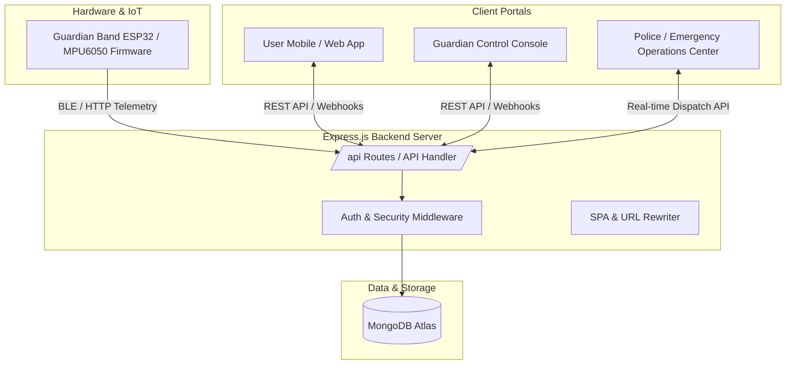

# 🛡️ Guardian AI — AI-Powered Personal Safety & Emergency Response Ecosystem

**Guardian AI** is an advanced AI-powered personal safety, emergency response, and real-time monitoring platform. It connects **Users** (individuals seeking safety monitoring & tracking), **Guardians** (family, friends, or designated protectors), and **Emergency Response Operations Centers (Police / First Responders)** into a unified ecosystem.

---

## 🏗️ System Architecture



---

## 🌟 Key Features

1. **User Safety Portal (`/user/dashboard/index.html`)**
   - Live GPS tracking and location sharing
   - Safe Journeys with route deviation and ETA monitoring
   - SOS Emergency Alert triggering
   - Guardian pairing via unique Guardian ID
   - Smart Wearable / Band synchronization (heart rate, fall detection)
   - Acoustic distress recording and playback

2. **Guardian Console (`/guardian/dashboard/index.html`)**
   - Real-time safety overview of linked users (battery, location, status)
   - Manage multiple wards/monitored users in one unified dashboard
   - Pair with users via Guardian ID
   - Listen to emergency acoustic recordings
   - Alert controls and sensitivity customization

3. **Emergency Operations Center / Police Dispatch (`/emergency` & `/guardian_emergency_portal`)**
   - Real-time incident dispatch table
   - Incident severity ratings and live GPS coordinates
   - Interactive responder distance and route mapping
   - Incident lifecycle management (`Pending` ➔ `Dispatched` ➔ `In Progress` ➔ `Resolved`)

4. **IoT Smart Band Firmware (`/firmware`)**
   - ESP32 / Arduino firmware for wearable Guardian Band
   - MPU6050 accelerometer & gyroscope integration for automatic fall detection
   - Emergency distress button triggering

---

## 🚀 Getting Started

### Prerequisites
- [Node.js](https://nodejs.org/) (v16 or higher)
- [MongoDB](https://www.mongodb.com/) (Local or MongoDB Atlas)

### Setup & Installation

1. **Clone the repository:**
   ```bash
   git clone https://github.com/chodi44/guardian-ai.git
   cd guardian-ai
   ```

2. **Install backend dependencies:**
   ```bash
   npm install
   ```

3. **Configure Environment Variables:**
   Copy `.env.example` to `.env`:
   ```bash
   cp .env.example .env
   ```
   Edit `.env` with your MongoDB connection string and desired port:
   ```env
   PORT=8000
   MONGODB_URI=your_mongodb_connection_string
   ```

4. **Start the Guardian AI Server:**
   ```bash
   npm start
   ```
   The server will run on `http://localhost:8000`.

---

## 📍 Portal Access Points

When the server is running on `http://localhost:8000`:
- **Main Landing Page:** [http://localhost:8000/](http://localhost:8000/)
- **User Portal:** [http://localhost:8000/user/dashboard/index.html](http://localhost:8000/user/dashboard/index.html)
- **Guardian Console:** [http://localhost:8000/guardian/dashboard/index.html](http://localhost:8000/guardian/dashboard/index.html)
- **Emergency Operations Center:** [http://localhost:8000/emergency](http://localhost:8000/emergency)
- **Emergency Dispatch Portal (Standalone):** [http://localhost:8000/guardian_emergency_portal/index.html](http://localhost:8000/guardian_emergency_portal/index.html)

---

## 📄 License
ISC License.
