# Guardian AI — Complete System Flowcharts

These flowcharts outline the end-to-end architecture, user/guardian portals, wearable hardware, and emergency response workflows for the Guardian AI smart band. This document has been thoroughly revised to address robust system behaviors, secure access, edge cases, and offline fallbacks.

## 1. End-to-End Architecture

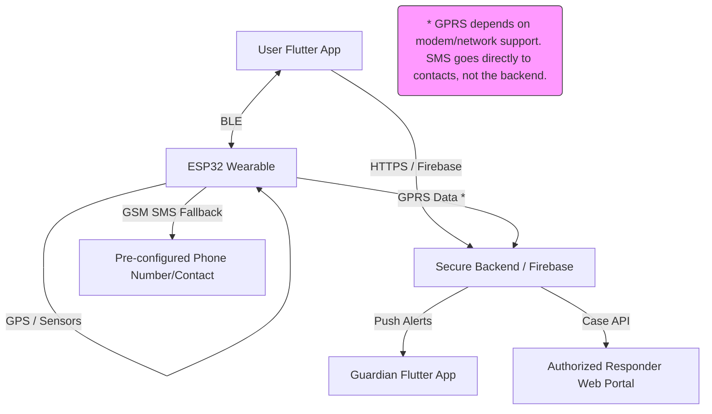

## 2. Starting Screen and Account Selection

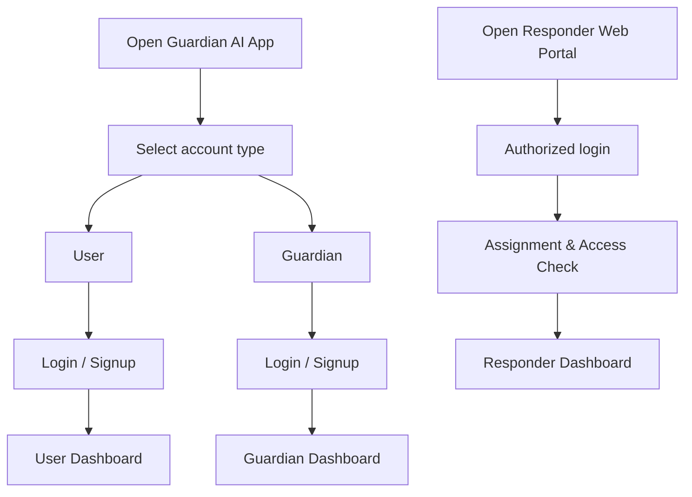

## 3. Firebase Authentication & Role-Based Access

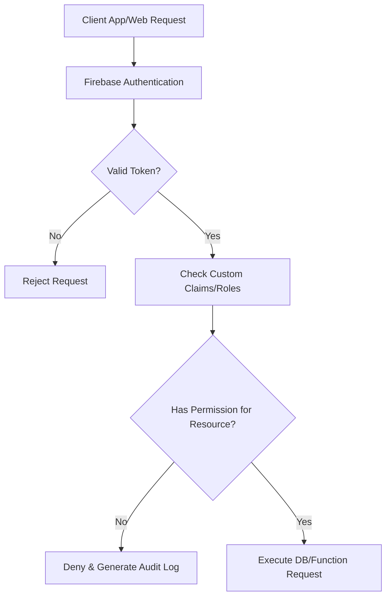

## 4. User Signup, Profile, Unique ID

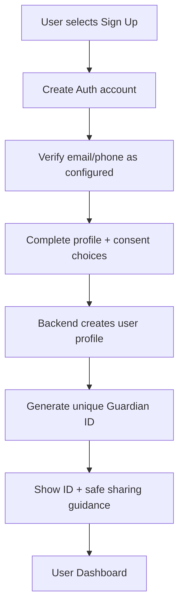

## 5. Guardian Signup, Link Request, User Approval

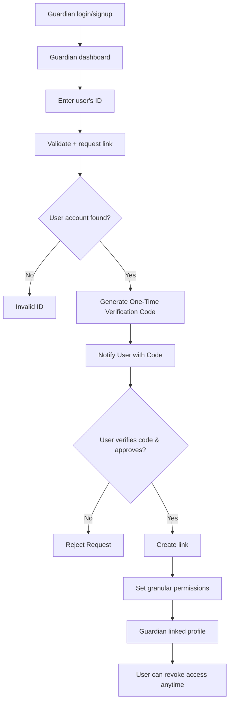

## 6. Guardian Unlinking and Permission Revocation

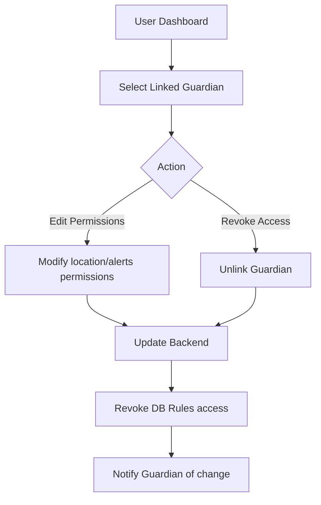

## 7. Wearable Pairing and Secure Setup

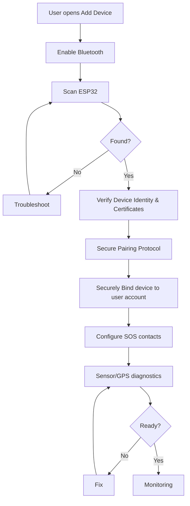

## 8. Normal Monitoring & Hardware Checks

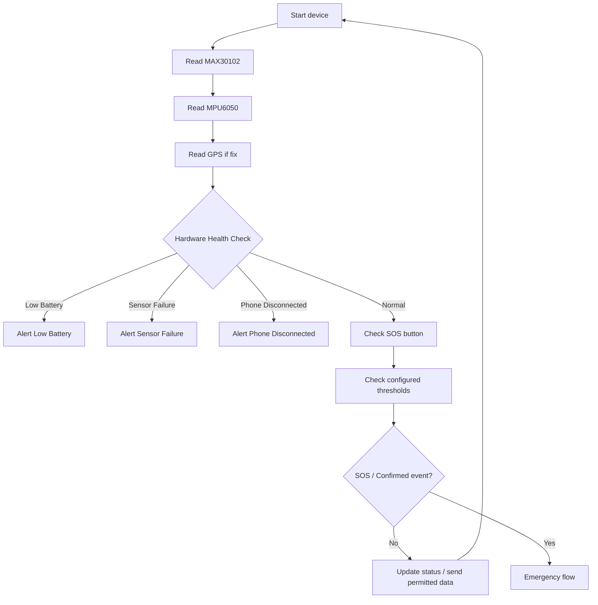

## 9. SOS Incident Creation, Escalation & Delivery

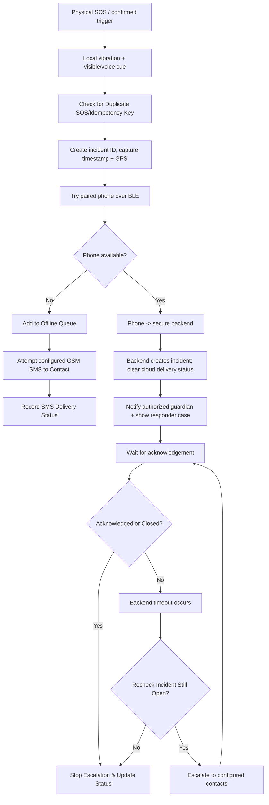

## 10. Incident Cancellation and Duplicate Handling

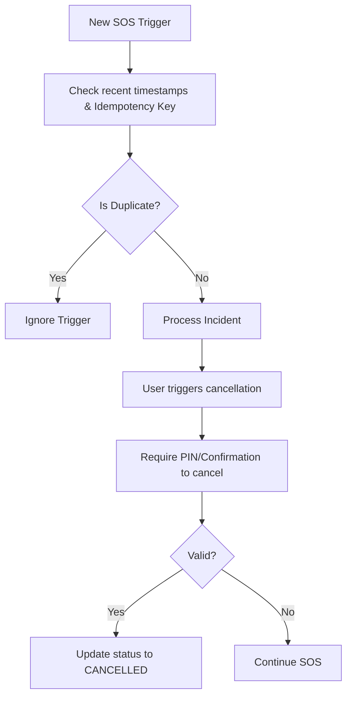

## 11. Fall/Impact Detection

```mermaid
flowchart TD
    Read[Read MPU6050] --> Analyze[Analyze motion pattern]
    Analyze --> Poss{Possible fall?}
    
    Poss -->|No| Read
    Poss -->|Yes| Warn[Configurable Warning / Countdown]
    
    Warn --> CancelConf{User cancels (false positive)?}
    CancelConf -->|Yes| LogCancel[Cancel SOS & Log false positive]
    LogCancel --> Read
    
    CancelConf -->|No (Timeout)| SOS[Start SOS]
```

## 12. Optional Audio Capture

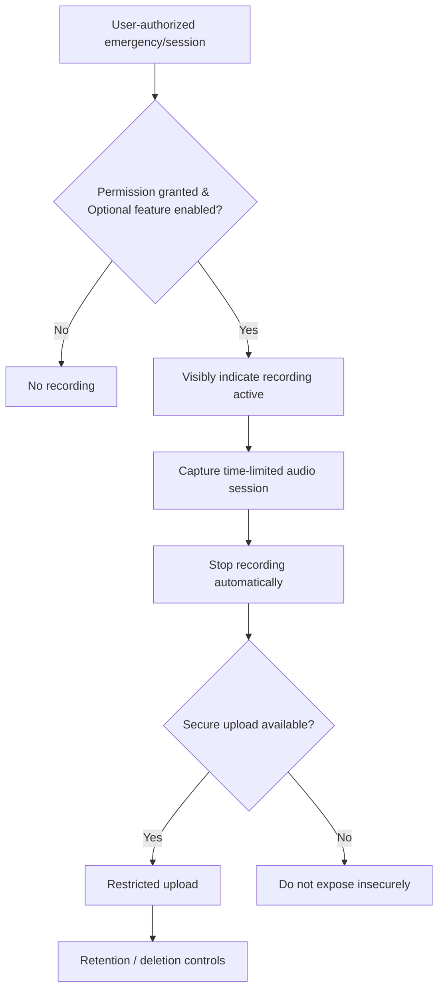

## 13. GPS Location and Freshness

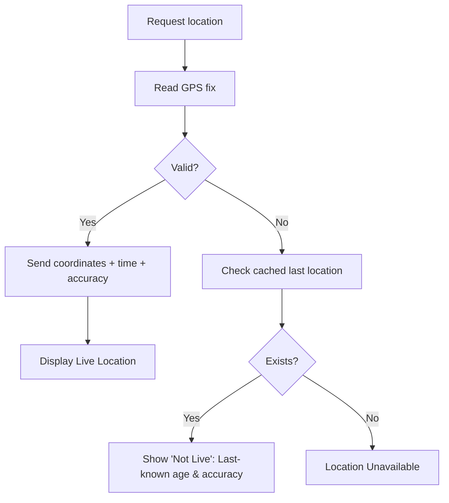

## 14. Device Disconnection & Reconnection

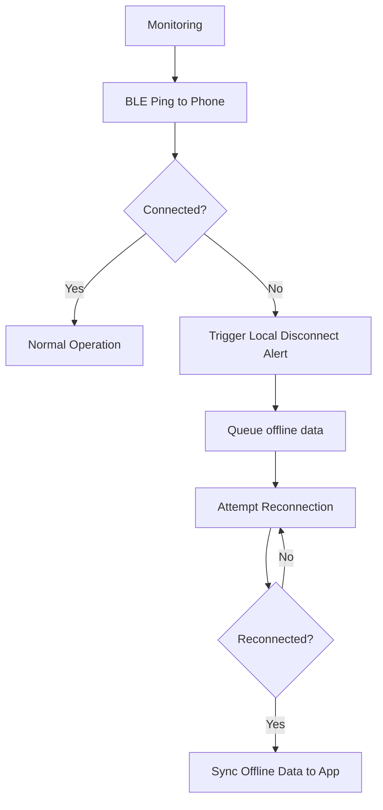

## 15. Offline Recovery and Synchronization

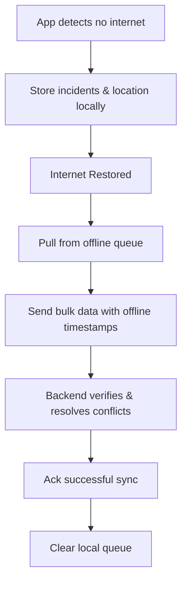

## 16. Responder Web Portal (Restricted)

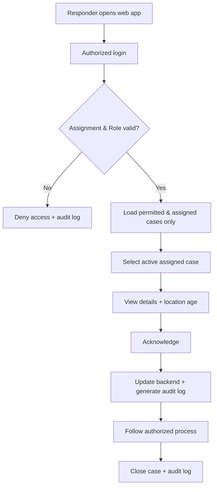

## 17. Notification Retry and Delivery Status

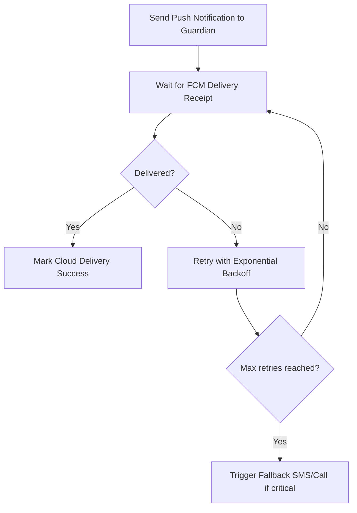

## 18. Emergency Contact Setup and Verification

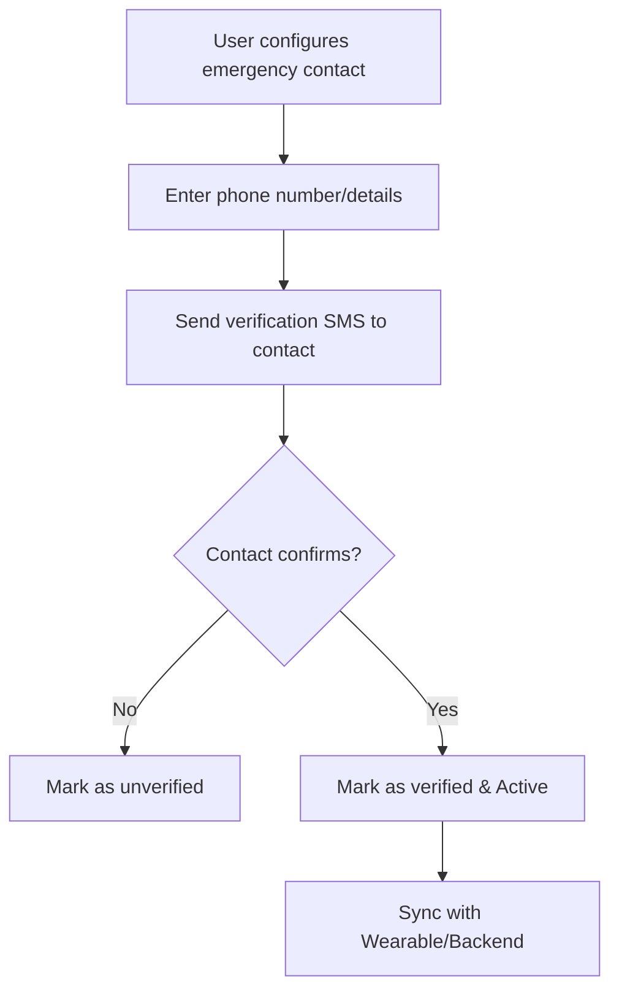

## 19. Admin/Device Provisioning

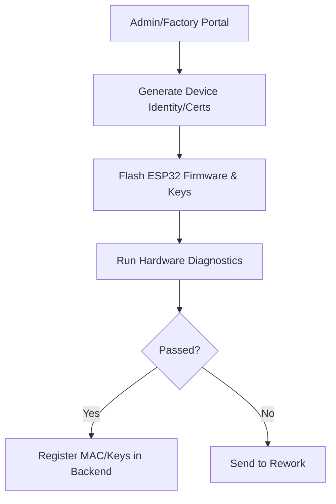

## 20. End-to-End Testing and Failure Scenarios

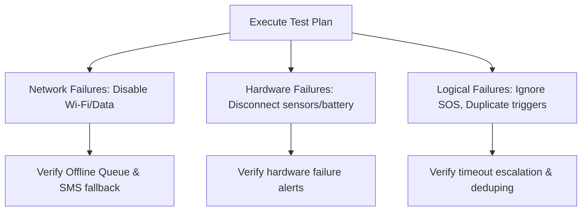
