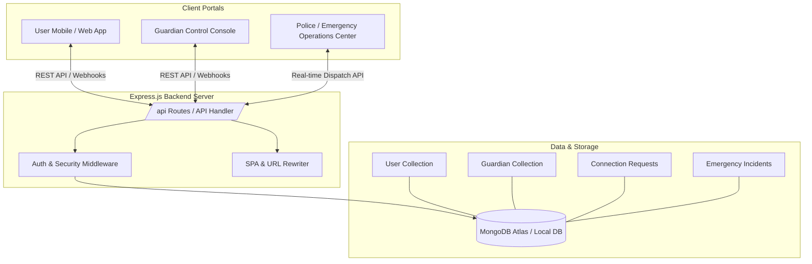

# 🛡️ Guardian AI — Comprehensive Platform Architecture & Feature Documentation

## 📌 Executive Overview
**Guardian AI** is an advanced AI-powered personal safety, emergency response, and real-time monitoring ecosystem. It connects **Users** (individuals seeking safety monitoring & tracking), **Guardians** (family, friends, or designated protectors), and **Emergency Response Operations Centers (Police / First Responders)** into a unified platform.

---

## 🏗️ Core System Architecture



---

## 🌐 1. Major Web Portals & Interfaces

### 📱 A. User Portal (`/user/dashboard/index.html` & subpages)
Designed for the individual using Guardian AI for safety tracking.
* **Live GPS & Location Sharing (`#location`):** Tracks current coordinates, precision, and route history.
* **Safe Journeys (`#journeys`):** Set start/destination coordinates, expected ETA, and auto-alerts if off-route or delayed.
* **Guardian Management (`#guardians` & `#guardian-id`):** View unique Guardian ID, send/accept connection requests, and manage trusted contacts.
* **SOS Emergency Alert (`#sos`):** One-tap triggering of high-priority emergency alerts dispatching location & status to Guardians and Emergency Centers.
* **Smart Wearable / Band Sync (`#band`):** Connects to smart bands/wearables for heart-rate monitoring, drop/fall detection, and biometric alerts.
* **Acoustic & Voice Safeguards:** Emergency voice note recordings and acoustic distress keyword detection.

---

### 🛡️ B. Guardian Console (`/guardian/dashboard/index.html` & subpages)
Designed for designated safety guardians (parents, family members, trusted contacts).
* **Live Safety Overview (`#overview`):** View real-time status, battery levels, connection state, and last reported location of linked users.
* **Linked Users (`#linked-users`):** Manage multiple wards/monitored users in one dashboard.
* **Connect User (`#connect`):** Enter a user's Guardian ID to request connection.
* **Acoustic Alerts (`#acoustic` / `voice-mails.html`):** Listen to emergency audio recordings triggered during distress alerts.
* **Permissions & Alert Controls (`#permissions`):** Customize notification sensitivity, geofence breaches, and speed/drop alerts.

---

### 🚨 C. Emergency Operations Center / Police Dispatch (`/emergency`, `/police`, `/guardian_emergency_portal`)
Dedicated dashboard for emergency dispatchers, law enforcement, and medical first responders.
* **Incident Dispatch Table:** Displays active SOS calls, severity ratings, live GPS coordinates, and user contact details.
* **Live Route & Radius Mapping:** Interactive map showing responder distance to incident locations.
* **Status Management:** Transition incidents between `Pending`, `Dispatched`, `In Progress`, and `Resolved`.

---

## 🗄️ 2. Data Models (MongoDB Schemas)

1. **`User` ([User.js](file:///c:/Users/chodi/Downloads/gaurdian%20ai%203/gaurdian%20ai/models/User.js))**
   - Credentials (name, email, password via bcrypt hash)
   - `guardianId` (Unique identifier for pairing)
   - `linkedGuardians` (Array of connected Guardian references)
   - `currentLocation` (Latitude, longitude, timestamp, address)
   - `safetyStatus` (`safe`, `warning`, `sos`)

2. **`Guardian` ([Guardian.js](file:///c:/Users/chodi/Downloads/gaurdian%20ai%203/gaurdian%20ai/models/Guardian.js))**
   - Guardian profiles & linked user arrays
   - Emergency contact numbers & notification preferences

3. **`ConnectionRequest` ([ConnectionRequest.js](file:///c:/Users/chodi/Downloads/gaurdian%20ai%203/gaurdian%20ai/models/ConnectionRequest.js))**
   - Pairing requests between Users and Guardians (`pending`, `accepted`, `rejected`)

4. **`EmergencyIncident` ([EmergencyIncident.js](file:///c:/Users/chodi/Downloads/gaurdian%20ai%203/gaurdian%20ai/models/EmergencyIncident.js))**
   - Logged SOS alerts containing triggering user ID, timestamp, coordinates, audio recording URLs, assigned response unit, and resolution status.

---

## 🔌 3. Key Backend API Endpoints (`/api`)

| Category | Method | Endpoint | Description |
| :--- | :--- | :--- | :--- |
| **Auth** | `POST` | `/api/auth/register` | Register new User or Guardian |
| **Auth** | `POST` | `/api/auth/login` | Authenticate & start session |
| **Pairing** | `POST` | `/api/connections/request` | Send pairing request using Guardian ID |
| **Pairing** | `GET` | `/api/connections/pending` | Fetch pending pairing requests |
| **Pairing** | `POST` | `/api/connections/respond` | Accept or decline connection request |
| **Location**| `POST` | `/api/user/location` | Update live user GPS coordinates |
| **Location**| `GET` | `/api/guardian/users-location` | Fetch live locations for all linked users |
| **SOS Call**| `POST` | `/api/emergency/sos` | Trigger high-priority emergency incident |
| **Police** | `GET` | `/api/emergency/incidents` | Fetch active emergency incidents for dispatch |
| **Police** | `PATCH` | `/api/emergency/incidents/:id`| Update incident status (e.g., Dispatched) |

---

## 🚀 4. How to Run the Application

The Node.js server serves both the Backend API and static Single-Page Application (SPA) frontends:

```bash
# 1. Install dependencies
npm install

# 2. Start the server (runs on Port 8000 by default)
npm start
```

### 📍 Access Points once running (`http://localhost:8000`):
* **Main Landing:** [http://localhost:8000/](http://localhost:8000/)
* **User Login:** [http://localhost:8000/login.html](http://localhost:8000/login.html)
* **User Portal:** [http://localhost:8000/user/dashboard/index.html](http://localhost:8000/user/dashboard/index.html)
* **Guardian Portal:** [http://localhost:8000/guardian/dashboard/index.html](http://localhost:8000/guardian/dashboard/index.html)
* **Emergency Dispatch Center:** [http://localhost:8000/emergency](http://localhost:8000/emergency)
